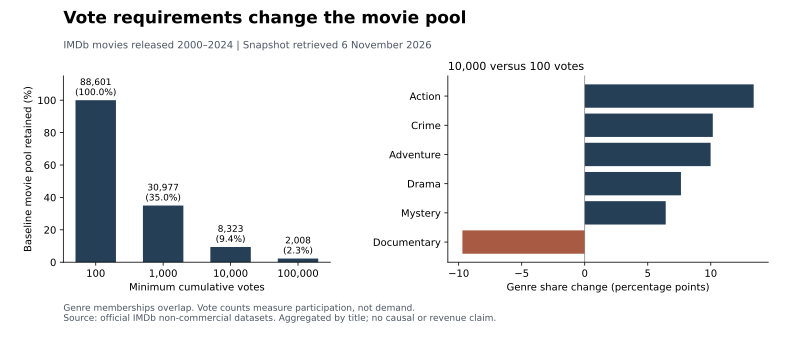

# IMDb Catalogue Selection Analysis

**Grace Ngo · SQL, SQLite and Python**

**Question:** How does requiring more votes change the coverage and genre mix of a rating-ranked movie shortlist?

This analysis quantifies a selection-policy trade-off: increasing a minimum-vote requirement gives a shortlist more audience participation support, but also changes which films can enter it. SQL joins, CTEs and window functions compare four eligibility rules; Python reconciles the calculations, measures shortlist turnover and produces aggregate reports.

## Results at a glance

Scope: non-adult movies released **2000–2024**, joined to observed IMDb ratings. The baseline contains **88,601 movies with at least 100 votes**. Official datasets were retrieved **6 November 2026**, with source run date **5 November 2026**.

| Minimum votes | Eligible movies | Baseline retained | Mean title rating | Baseline top-50 retained |
| ---: | ---: | ---: | ---: | ---: |
| 100 | 88,601 | 100.0% | 5.789 | 50 / 50 |
| 1,000 | 30,977 | 35.0% | 6.101 | 3 / 50 |
| 10,000 | 8,323 | 9.4% | 6.449 | 0 / 50 |
| 100,000 | 2,008 | 2.3% | 6.849 | 0 / 50 |

Raising the minimum from **100 to 10,000 votes**:

- Excludes **90.6%** of the baseline catalogue.
- Reduces Documentary share from **12.5% to 2.8%**.
- Increases Action share from **12.8% to 26.2%**.
- Replaces **all 50** baseline shortlist titles.
- Raises the equal-title mean rating from **5.789 to 6.449**. With release-year weights fixed to the baseline distribution, the difference is **+0.650 points**.



[Detailed findings](reports/research/findings.md) · [Threshold table](reports/research/threshold_summary.csv) · [Genre mix](reports/research/genre_mix.csv) · [Release-year sensitivity](reports/research/year_sensitivity.csv) · [Source fingerprints](reports/research/source_manifest.json)

## Decision relevance

For a catalogue analyst preparing a discovery or review shortlist, a vote floor is a coverage decision as well as a participation rule. A higher mean rating alone can conceal a much narrower candidate pool.

**Recommendation:** present retained-title counts, genre mix and shortlist overlap alongside the ranking. If discovery is part of the objective, maintain a separate lower-vote review queue so less widely rated films remain visible. Document the trade-off before choosing an eligibility rule.

This is decision support for selection-policy review. It does not identify an optimal cutoff or establish commercial demand: votes are cumulative participation counts and ratings summarize recorded audience evaluations.

## Analytical design

1. **Define a common population.** Join title and rating records on title ID; retain non-adult movies released in 2000–2024. Runtime availability is not an inclusion requirement.
2. **Compare four predefined floors.** Use 100, 1,000, 10,000 and 100,000 votes for counts, mean and median ratings, and baseline retention.
3. **Preserve genre membership.** Match exact genre tokens. Titles may have several tags, and unknown genres stay in the denominator; shares can sum above 100%.
4. **Measure shortlist turnover.** Rank by rating descending, votes descending and title ID ascending. Compare top-50 intersection, new entrants and Jaccard overlap with the baseline.
5. **Hold release-year composition fixed.** Compare within-year mean-rating differences using baseline-year weights. If a year has no eligible observations, the standardized comparison is left undefined.
6. **Reconcile calculations.** Independently compare SQL counts, means, medians and genre counts with Python calculations against the imported records.

The year-standardized result addresses release-year composition only. It does not remove audience, language, geography or survival selection. Higher observed ratings describe a different selected pool; they do not establish improved film quality.

## Reproduce the official-data analysis

Requires **Python 3.11+**. From the repository root:

```sh
python -m venv .venv
source .venv/bin/activate
python -m pip install -r requirements.txt
```

On Windows, activate with `.venv\Scripts\activate`.

Obtain `title.basics.tsv.gz` and `title.ratings.tsv.gz` from [IMDb's official dataset documentation](https://developer.imdb.com/non-commercial-datasets/) under its terms, and place them in a local `data/` directory.

```sh
python -m imdb_analytics.importer \
  --basics data/title.basics.tsv.gz \
  --ratings data/title.ratings.tsv.gz \
  --output data/research.sqlite
python -m imdb_analytics.research \
  --database data/research.sqlite \
  --output outputs/research
python -m unittest discover -s tests -v
```

The importer streams the files, validates fields, records input SHA-256 hashes and builds a local SQLite movie subset. It refuses an existing destination and removes partial output after failure. The analysis opens the database read-only.

Generated outputs include threshold, genre and release-year CSV tables; a combined JSON result; findings; a run manifest with input fingerprints; and SVG/PNG charts. Raw files, SQLite databases and local outputs are ignored by Git.

**Snapshot reproduction:** IMDb refreshes its download URLs daily. The published [source manifest](reports/research/source_manifest.json) identifies the exact compressed inputs behind the results above. Reproducing those figures exactly requires those input snapshots; a new download is a new snapshot and may produce different results.

## Verification

The automated suite checks aggregation, exact genre membership, overlapping-genre denominators, deterministic ties, shortlist turnover, missing-year standardization, input validation, read-only database access and atomic imports. GitHub Actions runs the tests and the self-contained demonstration.

The published research aggregates include independent SQL/Python reconciliation. The small fictional verification fixtures are separate software tests; they are not the source of the official-data findings.

For an offline software demonstration after installing requirements:

```sh
python -m imdb_analytics.analysis --demo --output outputs/demo
```

The demonstration also supports runtime-bin summaries, genre coverage by decade and year-specific shortlists. [Methodological notes](docs/methodology.md) explain query definitions and corrections.

## Repository guide

| Path | Purpose |
| --- | --- |
| [research.py](imdb_analytics/research.py) | Threshold analysis, independent reconciliation and reporting |
| [vote_floor_research.sql](imdb_analytics/queries/vote_floor_research.sql) | Inspectable SQL with CTEs and window functions |
| [importer.py](imdb_analytics/importer.py) | Local TSV import, validation and source hashing |
| [reports/research](reports/research) | Published official-data aggregates, chart and source manifest |
| [tests](tests) | Numerical and behavioral checks |
| [analysis.py](imdb_analytics/analysis.py) | Additional catalogue queries and offline demonstration |
| [reports/demo](reports/demo) | Explicitly fictional software examples |
| [docs](docs) | Methodology and original-material fingerprints |

## Source and authorship

IMDb supplies the title, genre, rating and vote-count fields. IMDb retains rights to its data; the source TSV files and derived title database are not redistributed here. Consult its documentation for access conditions.

Grace Ngo authored the original DATA 200 notebooks in Fall 2025. The November 2026 research is a new analysis of official IMDb files. The original notebooks and fictional demonstrations are retained as supporting development material; the current findings come from the documented official-data snapshot.

[Portfolio case study](https://gracengg.github.io/case-studies/imdb-catalogue.html)

